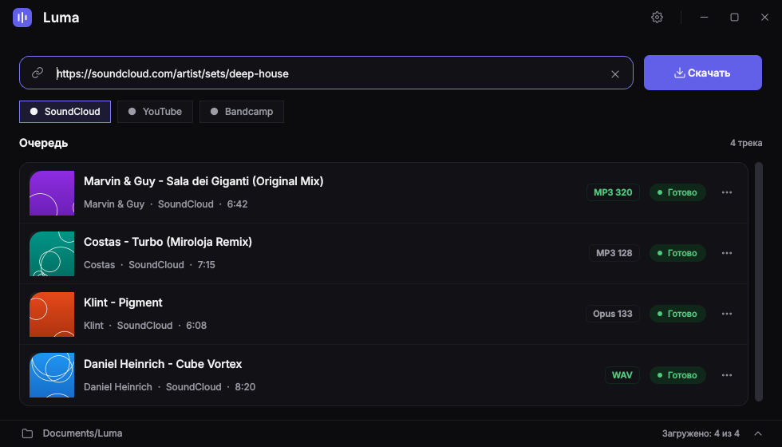

# Luma

Настольный инструмент для Windows: собирает личную музыкальную библиотеку
из публично доступных источников. Принимает список ссылок, скачивает
аудио, конвертирует в MP3 и встраивает обложки прямо в ID3-теги —
треки сразу готовы к работе в Rekordbox, Serato и Traktor.



## Возможности

- Очередь из любого числа ссылок — по одной в строке
- Поддержка YouTube, SoundCloud и Bandcamp: отдельные треки и плейлисты
- Плейлист сохраняется в отдельную папку со своим названием
- MP3, обложка внутри файла как ID3v2 APIC (Cover front)
- Чистка названий: без [FREE DL], OUT NOW, Premiere, (128 kbps), эмодзи
  и каталожных номеров; исполнитель подставляется, если его нет в названии;
  версия трека — (Original Mix), (X Remix) — остаётся
- Реальное качество источника в очереди: MP3 320, MP3 128, Opus, WAV
- Карточка трека с обложкой, исполнителем, источником и длительностью
- Докачка: повторная загрузка плейлиста берёт только новые треки
- Движок загрузки обновляется сам, без пересборки программы
- Ошибка одного трека не останавливает очередь; загрузку можно прервать
- Тёмный интерфейс, журнал выполнения, лог-файл в `%APPDATA%\Luma\luma.log`

## Установка

Нужна 64-битная Windows 10 или 11.

1. Скачайте архив со страницы **Releases** и распакуйте в любую папку.
   Подпись сборок оформляется через SignPath Foundation — см. раздел
   [Code signing policy](#code-signing-policy).
2. Запустите `Luma.exe`.

Больше ничего ставить не нужно: `ffmpeg.exe` уже лежит в архиве рядом
с программой. Если предпочитаете системную установку — удалите его
из папки и выполните `winget install Gyan.FFmpeg`, Luma найдёт ffmpeg
в `PATH`.

При первом запуске Windows покажет предупреждение «неизвестный
издатель» — программа не подписана платным сертификатом. Нажмите
«Подробнее» → «Выполнить в любом случае».

## Как пользоваться

1. Вставьте ссылки в поле — по одной в строке.
2. При необходимости выберите папку библиотеки (клик по пути внизу окна).
   По умолчанию используется `Документы\Luma`.
3. Нажмите **Скачать** или `Ctrl+Enter`.

Правый клик по строке очереди (или кнопка «…») — скачать заново,
показать файл в папке, скопировать ссылку, убрать из списка.

Горячие клавиши: `Ctrl+Enter` — начать, `Ctrl+L` — журнал,
`Ctrl+,` — настройки.

## Качество звука

Luma не может сделать трек лучше, чем его отдаёт площадка, и не делает
вид, что может. Значок справа в очереди показывает качество источника:

- **MP3 320**, **WAV**, **FLAC** — зелёный, клубное качество;
- **MP3 128**, **Opus 130** и подобное — серый.

Что отдают площадки: YouTube — Opus или AAC около 130–160 kbps;
SoundCloud — MP3 128, а если автор открыл скачивание, то оригинальный файл
(бывает WAV или MP3 320); Bandcamp — MP3 128 для прослушивания.

MP3-источник сохраняется бит в бит, без перекодирования. Остальное
конвертируется в MP3 320. Опция «Всегда перекодировать в MP3 320» сделает
320 и из MP3 128, но звук от этого не улучшится — подсказка у значка
честно напишет, из чего сделан файл.

## Сборка из исходников

Нужны Python 3.10+ и ffmpeg.

```powershell
git clone https://github.com/Siega4000/Luma.git
cd Luma
python -m venv .venv
.\.venv\Scripts\python.exe -m pip install -r requirements.txt
.\.venv\Scripts\python.exe main.py
```

Сборка exe:

```powershell
.\.venv\Scripts\python.exe -m pip install pyinstaller
.\.venv\Scripts\pyinstaller.exe --noconsole --onefile --name Luma --icon=luma.ico --add-data "luma.ico;." main.py
```

Готовый файл появится в `dist\Luma.exe`. Скрипт `build_portable.bat`
делает то же самое и дополнительно собирает портативный ZIP.

Проверка чистки названий: `python tests/test_names.py`.

Сборка выполняется и автоматически: при отправке изменений в `main`
GitHub Actions собирает exe на Windows и выкладывает архив
(файл `.github/workflows/build.yml`).

## Структура проекта

```
Luma/
├── main.py                     # точка входа
├── build_portable.bat          # портативная сборка одной командой
└── luma/
    ├── config.py               # настройки и папка библиотеки
    ├── core/                   # загрузка, теги, обновление движка
    │   ├── downloader.py       # движок поверх yt-dlp
    │   ├── names.py            # чистка названий
    │   ├── quality.py          # реальное качество источника
    │   ├── tagger.py           # встраивание обложек (mutagen, APIC)
    │   ├── worker.py           # фоновая очередь (QThread)
    │   ├── engine_update.py    # автообновление yt-dlp
    │   └── update_worker.py
    ├── ui/                     # интерфейс (PySide6)
    │   ├── theme.py            # дизайн-система
    │   ├── main_window.py      # главный экран
    │   ├── queue_view.py       # очередь загрузки
    │   ├── dialogs.py          # настройки и журнал
    │   └── …
    └── utils/                  # поиск ffmpeg, логирование
```

## Ограничения

Luma работает только с публично доступными материалами. Сервисы,
требующие входа в аккаунт (Spotify, Apple Music и подобные), не
поддерживаются, обхода технических средств защиты в программе нет.

## Ответственность

Инструмент предназначен для личного использования. Пользователь сам
отвечает за соблюдение авторских прав и условий использования площадок,
с которых скачивает материалы.

## Code signing policy

Free code signing provided by [SignPath.io](https://signpath.io/),
certificate by [SignPath Foundation](https://signpath.org/).

Подробности — в файле [`CODE_SIGNING_POLICY.md`](CODE_SIGNING_POLICY.md):
состав команды, процесс сборки и политика конфиденциальности.

## Лицензии

Код Luma распространяется по лицензии MIT — файл `LICENSE`.

Сторонние компоненты перечислены в `THIRD-PARTY-LICENSES.md`, полные
тексты их лицензий — в папке `licenses/`.

Отдельно про **ffmpeg**: он входит в релизный архив и распространяется
по GPL v3. Вместе с ним поставляются текст лицензии, точная версия
сборки (`FFMPEG-BUILD.txt`) и исходный код этой версии — отдельным
файлом на странице Releases. Подробности в `licenses/FFMPEG-NOTICE.md`.
